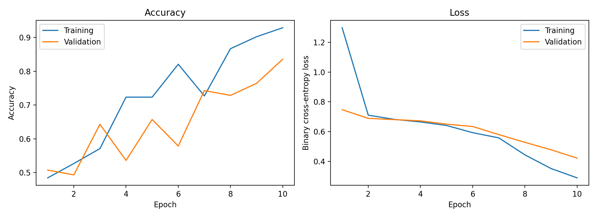

# Automated Two-Wheeler Helmet Detection Using a CNN

A Convolutional Neural Network (CNN) that looks at a picture of a rider and predicts whether the rider is wearing a helmet. Built with Keras and TensorFlow in Google Colab.

- **Class 0:** With_Helmet
- **Class 1:** Without_Helmet

The intended real-world use is smart traffic law enforcement: cameras at busy junctions (for example Swargate, Shivajinagar and Hinjawadi in Pune) send rider images to the model, and a Without_Helmet prediction could log an e-challan entry for a person to review.

## Repository contents

| File or folder | Description |
| --- | --- |
| `helmet_cnn_training.ipynb` | Complete notebook: download the data, build the folders, train, evaluate, save |
| `helmet_dataset/` | The balanced dataset used for training: `With_Helmet/` and `Without_Helmet/` (352 pictures each) |
| `helmet_cnn.keras` | The trained model |
| `learning_curves.png` | Accuracy and loss curves from training |

## Dataset

The pictures come from the public **Bike Helmet Detection** project on Roboflow Universe: <https://universe.roboflow.com/bike-helmets/bike-helmet-detection-2vdjo> (version 1, `multiclass` export).

- The download has 1,371 pictures in total (1,182 train, 126 valid, 63 test). Labels are stored in a `_classes.csv` file in each split.
- 1,189 pictures had one clear label: 837 With_Helmet and 352 Without_Helmet.
- The notebook sorts the pictures into two folders using the labels and keeps 352 of each class, so the classes are balanced (704 pictures in total).
- Split: 80% training (564 pictures) and 20% validation (140 pictures), resized to 64 x 64 x 3.
- The pictures mostly show whole riders and scenes, including cyclists, not close-up head crops.

Please check the dataset's license in the Roboflow project page or in `README.dataset.txt` (included in the original download) before reusing the pictures, and credit the original authors.

## Model

```
Input 64 x 64 x 3
  -> Rescaling (pixel / 255)
  -> Conv2D (32 filters, 3x3, same padding, ReLU)   -> 64 x 64 x 32
  -> MaxPooling2D (2x2)                              -> 32 x 32 x 32
  -> Flatten                                         -> 32,768
  -> Dense (128, ReLU)
  -> Dense (1, Sigmoid)   -> probability of Without_Helmet
```

- Total parameters: 4,195,457
- Loss: binary cross-entropy
- Optimiser: Adam, learning rate 0.001
- Training: 10 epochs, batch size 32
- Prediction rule: probability of 0.5 or higher means Without_Helmet

## Results

Values printed by the notebook on the 140 validation pictures:

| Metric | Result |
| --- | --- |
| Training accuracy | 92.9% |
| Validation accuracy | 83.6% |
| Generalisation gap | 9.3 percentage points |
| Training loss | 1.2977 (epoch 1) to 0.2884 (epoch 10) |
| Validation loss | 0.4214 |

Confusion matrix (rows are the true class, columns the predicted class):

| | Predicted With_Helmet | Predicted Without_Helmet |
| --- | --- | --- |
| **Actually With_Helmet** | 62 | 7 |
| **Actually Without_Helmet** | 16 | 55 |

| Class | Precision | Recall | F1-score |
| --- | --- | --- | --- |
| With_Helmet | 0.795 | 0.899 | 0.844 |
| Without_Helmet | 0.887 | 0.775 | 0.827 |



The model learns the task, but training accuracy is clearly higher than validation accuracy, which shows overfitting on a small dataset. Most errors are riders without a helmet that were predicted as wearing one.

## How to run

1. Open `helmet_cnn_training.ipynb` in Google Colab.
2. Add your Roboflow API key to Colab Secrets with the name `ROBOFLOW_API_KEY` and allow notebook access. Never paste the key directly into the notebook.
3. Run the cells from top to bottom. The notebook downloads the dataset, builds `helmet_dataset/`, trains the model, prints the metrics, saves the learning curves and saves `helmet_cnn.keras`.

To predict on one image after training:

```python
label, prob = predict_helmet("path/to/rider.jpg")
print(label, f"(P(Without_Helmet) = {prob:.3f})")
```

## Limitations

- The dataset is small (704 balanced pictures), so accuracy varies between runs and the model overfits.
- The pictures are whole scenes with cyclists and motorcycle riders, so a real system would first need to locate each rider and head, for example with an object detector.
- Rare head coverings such as turbans, caps and scarves may be under-represented, which can cause biased errors. Any real enforcement use needs human review before a challan is issued.

## Future work

- YOLO object detection and tracking to find riders and heads in live video
- Licence plate recognition to complete the e-challan
- Fine-tuning a pre-trained MobileNetV2 with a larger and more varied dataset
- Data augmentation, dropout and early stopping to reduce overfitting

## Author

Moiz Shaikh, Computer Engineering
